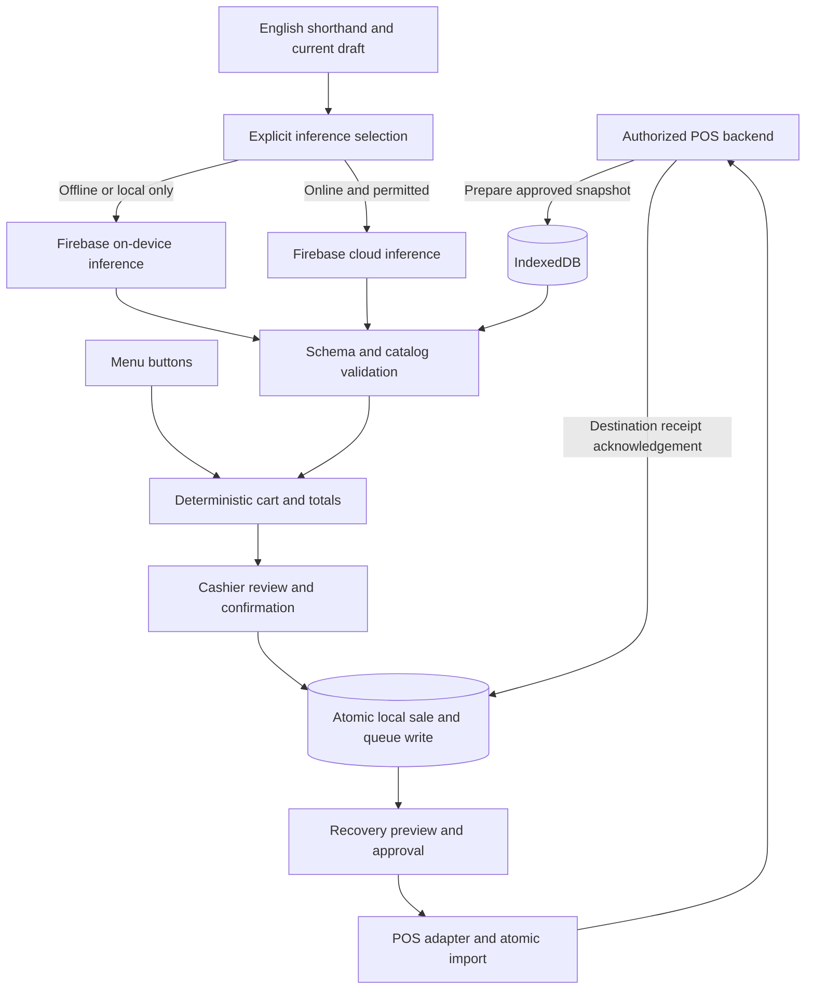

# BlackOutBridge architecture

BlackOutBridge is a prepared backup checkout that records new restaurant sales during a POS or connectivity outage and reconciles them afterward. The selected first-release scope is one restaurant, one backup cashier, cash recording, and one connector to an authorized POS backend.

Architecture status: selected implementation plan. Runtime compatibility, backend integration, offline restart behavior, and product acceptance remain unverified.

## Components

| Component | Choice | Responsibility |
| --- | --- | --- |
| Interface | React, TypeScript, Vite | Prepare, checkout, receipts, and recovery screens |
| App cache | Service worker | Previously downloaded app assets and offline startup |
| Local records | IndexedDB through Dexie | Catalog snapshots, drafts, confirmed sales, payments, and import queue |
| AI access | Firebase AI Logic and App Check | Explicit local and cloud calls, observed inference source |
| Validation | Zod and catalog lookups | Accept only supported item identifiers, quantities, and modifiers |
| Pricing | Pure TypeScript functions | Integer arithmetic from approved catalog prices |
| Recovery | Adapter to an authorized POS backend | Preview, atomic import, status lookup, and exceptions |
| Static hosting | Firebase Hosting | HTTPS app delivery on the project subdomain |

No paid image generation, voice transcription, new domain, or Cloud Functions is required by this design. Cloud inference and hosting remain subject to the selected plans and quotas. Initial SDK and build dependencies are pinned in package.json and package-lock.json. The installed Firebase packages require Node 24.12 or newer. The readiness scaffold is separate from the unimplemented checkout and recovery features.



## Preparation

The operator downloads the app assets, local model, approved catalog snapshot, prices, supported rules, and an offline-capable local session while connected. A user-initiated preparation action initializes the local model through the SDK before the first query. The preparation screen shows the snapshot timestamp and results of readiness checks. Loading the site online once is not sufficient evidence of offline readiness.

An API-issued snapshot retains source item identifiers and its version in the destination backend. A manually imported CSV can support local checkout, but automatic recovery requires reviewed mappings and a backend-approved price snapshot. Never infer prices from a menu image and silently treat them as approved.

## Order entry and inference

The catalog is data in IndexedDB. It is not model training material or a model-generated authority. Retrieve a bounded set of candidates from catalog names and aliases before requesting interpretation. Unmatched input can use ordinary search or clarification.

The first version uses one-turn model requests. For a correction, provide the current draft and new instruction in a fresh request; do not rely on unsupported local chat history or function calling. A model proposes a complete replacement draft or asks a clarification. It cannot save sales, authorize payments, change stored prices, or call backend tools.

Online cloud calls are allowed only for an explicitly permitted input. Local-only requests must use a mode that cannot silently fall back to the cloud. While offline, use the previously downloaded on-device model; if inference fails, keep ordinary menu entry available. Actual service responses and the SDK's reported inference source determine the displayed result. A browser online indicator is advisory.

SDK support for local inference, initial model download, and offline App Check behavior must be tested on the intended device before the product promises offline AI. The documented web path requires supported desktop Chrome. Mobile cloud access does not establish mobile on-device support.

## Checkout and money

All authoritative amounts come from the approved catalog and deterministic code. The business configuration uses Thai baht minor units (satang), with `currency = THB` and application `scale = 2` (for example, `7500` satang = `฿75.00`). All base prices, line totals, and bill totals must be safe nonnegative integers; reject overflow.

Support item quantities, grouped/required option selections with signed approved modifier price deltas (requiring nonnegative effective unit price), totals, cash received, and change. Initial prices are final catalog prices; discounts, tax calculation, service charges, mixed tenders, refunds, and edits to already open POS checks are outside the first release. An overpayment produces change only in the cash workflow. Insufficient cash must remain unpaid unless the cashier revises the entry.

The cashier confirms the complete cart. Save the sale, cash record, and queue entry in a single IndexedDB transaction. Display a saved receipt only after that transaction succeeds. Keep confirmed financial records immutable; errors become visible manager-review exceptions rather than silent overwrites or deletion.

## Payment states

| State | Meaning |
| --- | --- |
| UNPAID | No received payment is recorded |
| CASH_RECORDED | The cashier attests to receiving the recorded cash |
| EXTERNAL_UNVERIFIED | An external reference exists; provider success is not verified |

The first release fully supports cash. External references are review-only and must remain unresolved until checked through a supported provider workflow. Card processing and offline card storage remain inside a compatible provider SDK and terminal. Importing an order must not create a card charge or convert unresolved payment evidence into a paid status.

## Local records and recovery

Use the canonical contracts in [CONTRACTS.md](CONTRACTS.md). Persist a stable device identifier and random sale identifier, confirmed lines, captured prices, catalog version, original total, recorded timestamp, payment state, and queue state. Raw natural-language input is optional local debugging data, off by default; it is not required in a POS import.

Queue states are `PENDING`, `REVIEW_REQUIRED`, and `IMPORTED`. Transient network failure leaves an entry pending with its attempt metadata. Mark imported only after receiving or retrieving the destination receipt acknowledgement. A committed sale remains visible locally after import.

Preview imports before committing. The backend rechecks permissions, mappings, supported rules, and the historical approved snapshot at commit time. It derives tenant and restaurant scope from authentication; it must not trust a tenant identifier supplied in the payload.

Enforce a backend uniqueness constraint on `(tenantId, sourceDeviceId, saleId)` and compare a canonical immutable payload digest. Repeating the same request returns the original receipt. Reusing the identifier with different content returns a conflict. The native sale, supported inventory effects, import ledger entry, and receipt mapping must commit in the same database transaction. A preview is not an import acknowledgement.

Recovery imports completed historical sales. It must not resend already fulfilled kitchen tickets, initiate a payment, or silently reprice the amount previously collected. Missing items, historical price mismatches, revoked permissions, unsupported rules, and changed payloads go to exception review. A committed backend transaction with a lost HTTP response is resolved through status lookup or an identical retry.

Each sale in a batch is atomic and reports its own outcome. A partially imported batch must be resumable without duplicating the successful sales. The exact implementation depends on the native POS schema and authorized API; a separate sandbox receiver must be identified as such and cannot be presented as proven native integration.

## Operational boundaries

- A charged prepared device is required. Software cannot power a dead terminal, router, or printer.
- Snapshot availability can be stale. Display its date and allow local sold-out marks. There is no disconnected multi-register stock coordination.
- Authentication expiry must not erase local records. Reauthorize remote access during recovery and show revoked access as an exception.
- Request persistent browser storage where supported and offer a local export of pending sales. User deletion, browser storage eviction, and device loss remain possible.
- Minimize stored customer information. IndexedDB storage is not automatically a claim of encryption or tamper resistance.
- Keep secret backend credentials server-side. Do not put service-account keys or private API tokens in Vite variables.
- App Check is required for the Firebase integration. Firebase configuration, keys, and debug setup are supplied through local configuration, with no live values in this repository.

## Source layout after implementation

```text
src/
  ai/                 model access, prompts, proposal validation
  components/         shared presentation components
  features/prepare/   catalog loading and offline readiness
  features/checkout/  menu entry, proposal review, cart, and cash receipt
  features/recovery/  import preview, retries, and exception review
  domain/             shared types, catalog rules, and money calculations
  storage/            IndexedDB repositories and atomic transactions
  sync/               connector interface and durable queue behavior
  pwa/                service worker and cache version handling
server/               authorized connector implementation or clearly labeled reference
tests/                source tests with minimal synthetic inputs
docs/                 technical documentation needed to build and verify the product
```

## Sources

- [Firebase hybrid web support and limitations](https://firebase.google.com/docs/ai-logic/hybrid/web/get-started)
- [Inference selection and observed source](https://firebase.google.com/docs/ai-logic/hybrid/web/configuration-options)
- [Firebase pricing](https://firebase.google.com/docs/ai-logic/pricing)
- [Firebase Hosting](https://firebase.google.com/docs/hosting)
- [Hackathon rules and App Check requirement](https://firebasehybridaihackathon.devpost.com/rules)
- [Square's documented idempotent order creation pattern](https://developer.squareup.com/reference/square/orders-api/create-order)
